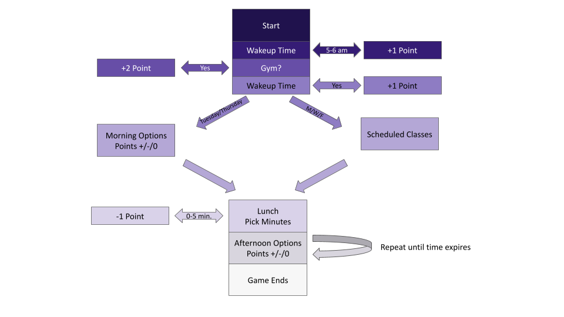

# STAT 199: Intro to Python Project Draft Code
This project draft simulates a weekly schedule where the player is randomly assigned a day to play. The player gets to make choices on what they should do in their free time. The player wins the game by earning at least 7 points, but cannot see how many points each choice is worth before selection. 

## How To Play
The game begins with a series of print statements. The first one informs the player which day they have been randomly assigned to play. To second describes that to win, the player needs to score 7 points. The tricky part is that the player does not know how many points anything is worth ahead of time. If the player did know, they could obviously maximize points every round so instead the game relies on the player's decision-making skills and time-management abilities. The third print statement includes what that day's schedule includes. An observant player should use the schedule as a clue for what later options will be the most beneficial. The last print statement prompts the player to select a wakeup time between 5-7 am.

Selecting a wakeup time is the players first opportunity to score points. After that, the player is prompted to select if they want to go to the gym and if they want to do chores. These are also points scoring opportunities. 

On Tuesdays and Thursdays, the player is then prompted to select one morning activity that could gain them points (the point total could be zero or even negative). Regardless of day, all players input how much time they will spend eating lunch. This is then subtracted from how much free time the player has in the afternoon to do afternoon activties before the day ends. Then the player is presented with the afternoon activity choices, which they can select from until time is up. At the end of the game, there is a print statement that informs the player how many points they scored and if they won or lost. 

## Files Included
### run_game.py
This is the main file that includes the driver code that enables game play. It includes the vast majority of functions for the game. 
For each day, there is one wakeup function called where the player decides what time to wake up at. There is also a set of morning choices every day where the player can choose whether or not to do chores or go to the gym. Each day has a lunch function that allows the player to input how long they will eat lunch for and then subtract that amount of time from their afternoon free time. The afternoon activity functions keep track of how much more time there is and will recusively run if there is enough time for the player to complete more activties. The afternoon functions also execute the corresponding lunch function. On Tuesday and Thursdays, there are also morning activity functions. Lastly, there is a function for each day that runs all the functions that make up a day. There is an overall game() function that executes the random selection of a day and provides the basic schedule for the day selected before launching the appropriate day's function. 

For more information about each specific functions included with run_game.py, please see the end of the *Functions Included* section.

### Daily Dictionaries
Each day has its own dictionary of possible activity choices for the afternoon. Tuesday and Thursday have additional dictionaries for morning activities. Each dictionary has a corresponding function that presents the options to the player and keeps track of the subsequent score from their choices. The dictionaries are stored in separate .py files that are imported into the main run_game.py file. For Tuesday and Thursday, both dictionaries are stored wtihin Tuesday.py and Thursday.py respectively. 

For more information about each specific dictionary, please see the *Dictionaries Included* section. 

## Functions Included
For each day, there is a wakeup function where the player decides what time to wake up at. There is also a set of morning choices every day where the player can choose whether or not to do chores or go to the gym. Each day has a lunch function that allows the player to input how long they will eat lunch for and then subtract that amount of time from their afternoon free time. Each day has its own dictionary of possible activity choices for the afternoon. Tuesday and Thursday have additional dictionaries for morning activities. Each dictionary has a corresponding function that presents the options to the player and keeps track of the subsequent score from their choices. The dictionaries are stored in separate .py files that are imported into the main run_game.py file. The afternoon activity functions keep track of how much more time there is and will recusively run if there is enough time for the player to complete more activties. The afternoon functions also execute the corresponding lunch function. Lastly, there is a function for each day that runs all the functions that make up a day. There is an overall game() function that executes the random selection of a day and provides the basic schedule for the day selected before launching the appropriate day's function. 

### early_morning_options
This function takes in user input and supplies them with yes/no choices in order to earn points. 

### wakeup
This function takes takes in user input to determine a wakeup time and allocates points according to a conditional. It includes input validation where ValueErrors are handled with a try/except block and input outside of the specified range are handled via conditionals. Any instance of invalid input is added to an invalid input counter where the user is allowed to attempt to enter valid input for up to three times. If the user cannot successfully enter valid input, the function "randomly" selects a time from a list and uses that. 

### Mon_lunch
This function allows the user to put in how many minutes they want to spend eating lunch and then converts it to hours which can be subtracted from the amount of time they have within their afternoon. If the user spends too little time eating lunch, one point is deducted. It is run within the corresponding afternoon function. It contains input validation that handles both exceptions and input outside of an expected range through randomly selection an amount of time from a specified interval. 

### afternoon_activity
This function allows the player to pick which activities they will do in the afternoon and earn/lose the corresponding number of points (see appropriate dictionary). It also tracks hours remaining within the function to determine how many times the user will be able to pick from the options.

### play_Monday
This function plays through all the functions that make up this day and includes a print statement at the end to let the player know if they won or lost. 

### Tue_morning_activity
This function allows the user to pick one activity to complete in the morning. 

### Tue_lunch
This function allows the user to put in how many minutes they want to spend eating lunch and then converts it to hours which can be subtracted from the amount of time they have within their afternoon. If the user spends too little time eating lunch, one point is deducted. It is run within the corresponding afternoon function. It contains input validation that handles both exceptions and input outside of an expected range through randomly selection an amount of time from a specified interval. 

### Tue_afternoon_activity
This function allows the player to pick which activities they will do in the afternoon and earn/lose the corresponding number of points (see appropriate dictionary). It also tracks hours remaining within the function to determine how many times the user will be able to pick from the options.

### play_Tuesday
This function plays through all the functions that make up this day and includes a print statement at the end to let the player know if they won or lost. 

### Wed_lunch
This function allows the user to put in how many minutes they want to spend eating lunch and then converts it to hours which can be subtracted from the amount of time they have within their afternoon. If the user spends too little time eating lunch, one point is deducted. It is run within the corresponding afternoon function. It contains input validation that handles both exceptions and input outside of an expected range through randomly selection an amount of time from a specified interval. 

### Wed_afternoon_activity
This function allows the player to pick which activities they will do in the afternoon and earn/lose the corresponding number of points (see appropriate dictionary). It also tracks hours remaining within the function to determine how many times the user will be able to pick from the options.

### play_Wednesday
This function plays through all the functions that make up this day and includes a print statement at the end to let the player know if they won or lost. 

### Thu_lunch
This function allows the user to put in how many minutes they want to spend eating lunch and then converts it to hours which can be subtracted from the amount of time they have within their afternoon. If the user spends too little time eating lunch, one point is deducted. It is run within the corresponding afternoon function. It contains input validation that handles both exceptions and input outside of an expected range through randomly selection an amount of time from a specified interval. 

### Thu_morning_activity
This function allows the user to pick one activity to complete in the morning. 

### Thu_afternoon_activity
This function allows the player to pick which activities they will do in the afternoon and earn/lose the corresponding number of points (see appropriate dictionary). It also tracks hours remaining within the function to determine how many times the user will be able to pick from the options.

### play_Thursday
This function plays through all the functions that make up this day and includes a print statement at the end to let the player know if they won or lost. 

### Fri_lunch
This function allows the user to put in how many minutes they want to spend eating lunch and then converts it to hours which can be subtracted from the amount of time they have within their afternoon. If the user spends too little time eating lunch, one point is deducted. It is run within the corresponding afternoon function. It contains input validation that handles both exceptions and input outside of an expected range through randomly selection an amount of time from a specified interval. 

### Fri_afternoon_activity
This function allows the player to pick which activities they will do in the afternoon and earn/lose the corresponding number of points (see appropriate dictionary). It also tracks hours remaining within the function to determine how many times the user will be able to pick from the options.

### play_Friday
This function plays through all the functions that make up this day and includes a print statement at the end to let the player know if they won or lost. 

### game()
This function uses a random generator to decide which day the user will play. After that, a conditional is used to run the appropriate play function and includes generalized and specific print statements. 

## Dictionaries Included

### Mon_afternoon_activity
This dictionary supplies 5 different activities where the intial keyword is the number the player will later select and the values are all nested dictionaries of the activity's name, score, and hours it takes. 

### Tue_afternoon_activity
This dictionary supplies 5 different activities where the intial keyword is the number the player will later select and the values are all nested dictionaries of the activity's name, score, and hours it takes. 

### Wed_afternoon_activity
This dictionary supplies 5 different activities where the intial keyword is the number the player will later select and the values are all nested dictionaries of the activity's name, score, and hours it takes. 

### Thu_afternoon_activity
This dictionary supplies 5 different activities where the intial keyword is the number the player will later select and the values are all nested dictionaries of the activity's name, score, and hours it takes. 

### Fri_afternoon_activity
This dictionary supplies 5 different activities where the intial keyword is the number the player will later select and the values are all nested dictionaries of the activity's name, score, and hours it takes. 

### Tue_morning_activity
This dictionary supplies 5 different activities where the intial keyword is the number the player will later select and the values are all nested dictionaries of the activity's name and score. 

## A Note on Global Variables
This program contains several global variables for the various hour trackers and for the overall score tracker. This was an intentional choice and they are used in a responsible manner. 

## Control Flow
Most of the control flow is maintained through tracking information onto the global variables (score, hours). There are also conditionals within the respective functions that allow for certain scores to be added to score depending on the option selected. There are loops within the functions that allow the program to iterate over the terms within the dictionaries. 

## Improvements from Draft Stage to Final Stage
While the majority of the code remains the same from the draft to the final stage, there was important fine-tuning and corrections that took place in the interim. Some of the updates, like fixing duplicated scoring or adding robust input validation, improve gameplay considerably even though most of the code looks the same. The changes between these stages are detailed below. 

### Input Validation
There was very little in the way of input validation at the draft stage. Now, there is considerable input validation namely for the wakeup() function's input time and the various lunch functions and their input of minutes spent on lunch. As mentioned in the *Functions Included* section, all the aforementioned functions now handle exceptions (namely ValueErrors) and input outside of a reasonable range through try/except blocks and condtionals. For the wakeup() function, this included allowing the user three opportunities to enter valid input before the function uses random.randomchoice() to select a time for the user from a list included inside the function. The lunch functions have a more simple input validation process where if invalid input is entered, they use random.randint to pick a time amount on an interval from 5-60.

I also considered adding in input validation for other input opportunities within the game. I ultimately decided not to for the early_morning_options() funcion and for all of the various activity functions because all invalid input means is that the player misses points, which feels like enough of a penalty for me. 

#### Added Penality in Lunch Functions
Previously it was incredibly advantageous to choose to spend zero minutes on lunch, and while that is a choice you could actually make, it's often a bad one. To reflect that, I added a penalty for a lunch that is under 5 minutes. Negative lunch times are taken care with input validation. 

### Typo Correction/Debugging
There were two major corrections that took place between the draft and final codes. The first was that under the Thursday afternoon function, I called the Tuesday afternoon dictionary which meant that the player saw the wrong activities. That typo has been corrected and now all activity functions call their appropriate dictionaries. The second correction was that I mistyped in  the hours inputs in all Friday related function as the Monday hours input, which caused a mismatch in times. Further, I also forgot to add in the argument when I called Fri_lunch inside of Friday_afternoon_activity and subsequently play_Friday. This resulted in the program crashing whenever Friday was generated to play. The argument has now been added and Friday is fully playable and reflects the appropriate hours amount for Friday instead of the Monday inputs. 

### Eliminated Scoring Redundancies
The final major improvement was that points were double counted in the draft code inside of all of the activity functions. They were double counted because I had both a loop that added respective points to the score and a conditional that did the same. This was from an earlier experiment at the draft stage where I tried various methods of keeping track of points. I thnk I forgot to delete the conditionals or didn't consider how points would be redundantly fed through both structures within the function. Those conditionals are gone from the activity functions within the final draft and points are only counted once. 

### Dictionary Files
Originally, the various dictionaries were all within the main file. I found it difficult to read with everything in the same place, so I removed them each to their own respective file which I believe has improved readability. I did experiment with moving all relevant functions to the file that corresponds with their day but I disliked how the global variables needed to be manipulated in that framework so I settled on this to improve readability while preserving the original flow of the code. 

### Docstrings
Due to all of the aforementioned updates, I updated several function docstrings in order to reflect changes made to aspects like input validation. I also have quite a few side effects considering I'm using global variables which I previously noted within the README but not within the respective docstrings. Now, the docstrings also mention relevant side effects. 

### Appreciation for Peer Reviews
I'm grateful for the time and thoughfulness of both of the peer reviews I received. They pointed out bugs and typos that I hadn't caught and pushed my code via tests I hadn't considered. While I did not use all of their suggestions, they were still helpful for developing improvements that I made to this project as it progressed to this draft. 